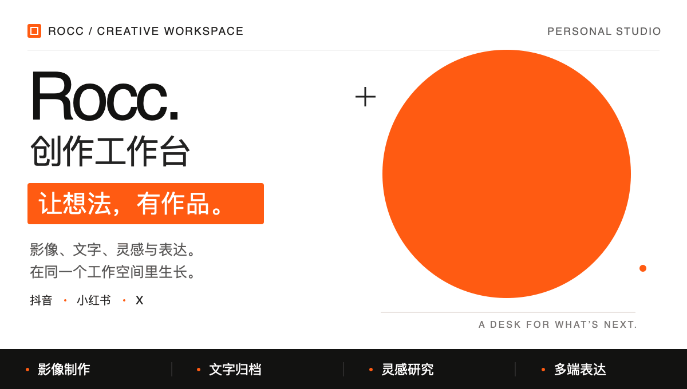

<p align="center">
  <picture>
    <source media="(prefers-reduced-motion: reduce)" srcset="./assets/readme/hero.svg">
    
  </picture>
</p>

从一期素材，到一份作品，再到多平台分发。面向 **抖音 · 小红书 · X** 的个人创作工作区。

[查看进度](待做清单.md) · [开始制作](工作流/内容生产.md) · [工作区规范](工作区规范/) · [Agent 入口](AGENTS.md)

> **当前可用**：本地素材与项目整理；作品文字版归档已有执行规范，Notion 连接已通过读写测试。
> **接下来**：验证一期真实作品归档。剪辑能力暂缓，灵感采集与跨平台分发尚未自动化。

## 开始一期内容

把视频、录音或文字稿放进 `收件箱/`，告诉助手本次目标：

> “把这批素材整理成一期内容。”
> “把这份文字版归档，先检查有没有重复作品。”

已有文字稿可以直接进入归档环节；已有成片可以从材料准备开始。每期内容的产物与进度集中保存在自己的项目目录里。

## 两条创作路径

**内容生产**
素材整理 → 剪辑制作 → 作品材料准备 → 文字版归档 → 多平台分发

**灵感选题**
全网搜集 → 保留来源 → 提炼选题 → 进入内容项目

以上是目标流程。各环节能否执行，以[内容生产工作流](工作流/内容生产.md)及[待做清单](待做清单.md)为准。

## 工作区地图

| 位置 | 放什么 |
| --- | --- |
| [收件箱/](收件箱/) | 新上传、尚未整理的素材 |
| [内容项目/](内容项目/) | 一期一个目录，集中放素材、剪辑、文稿和发布材料 |
| [灵感选题/](灵感选题/) | 来源链接、灵感与候选选题 |
| [历史归档/](历史归档/) | 旧作品、音频、转写、清单和脚本 |
| [工作区规范/](工作区规范/) | 适用于整个工作区的组织与维护约定 |
| [工作流/](工作流/) | 任务流程及环节执行文档 |
| [.agents/skills/](.agents/skills/) | 可复用的 Agent Skill 与工具 |

前四个目录只提交 `.gitkeep` 占位文件，本地创作资料另行迁移和备份；规范、工作流和 Skill 正常提交。克隆仓库即可获得入口结构。

## 规则与流程从哪里读

| 想了解什么 | 对应文档 |
| --- | --- |
| Agent 应遵守什么、遇到任务先读什么 | [AGENTS.md](AGENTS.md) |
| 三级文档如何分工，工具替换时改哪里 | [工作区规范 · 文档分层约定](工作区规范/文档分层约定.md) |
| 一期内容有哪些环节，各环节怎样算完成 | [内容生产工作流](工作流/内容生产.md) |
| 工作台已经做到哪一步 | [待做清单](待做清单.md) |

**Agent 入口 → 任务工作流 → 环节执行文档**。全局约束、任务流程、具体工具各归其位；工具和目标库的细节沿工作流继续读取。

## 素材留在本地

公开仓库保存规范、流程和可复用工具。本地素材、作品文稿、灵感记录、历史资料和凭据默认不提交；音视频、常见工程文件、压缩包另有扩展名忽略规则，详见 [.gitignore](.gitignore)。

Git 不会按文件大小自动忽略未知格式。忽略规则也不提供加密或备份，提交前仍需检查文件列表。

<details>
<summary>沿用历史转写脚本</summary>

旧资料整套保存在本地 `历史归档/2026-09-旧作品整理/`，文件名和内部相对位置保持原样；搬迁核对记录在 `历史归档/整理记录.json`。这些文件不随公开仓库分发。

在拥有这份本地归档的电脑上，从工作区根目录运行：

```sh
cd 历史归档/2026-09-旧作品整理
python3 asr_batch.py --help
```

实际转写依赖 `dashscope` 和有效凭据，并会调用外部服务。原脚本的 `--srt` 会跳过已有 `.txt` 的条目，补字幕时应使用新的输出目录，保留已有转写。

</details>
